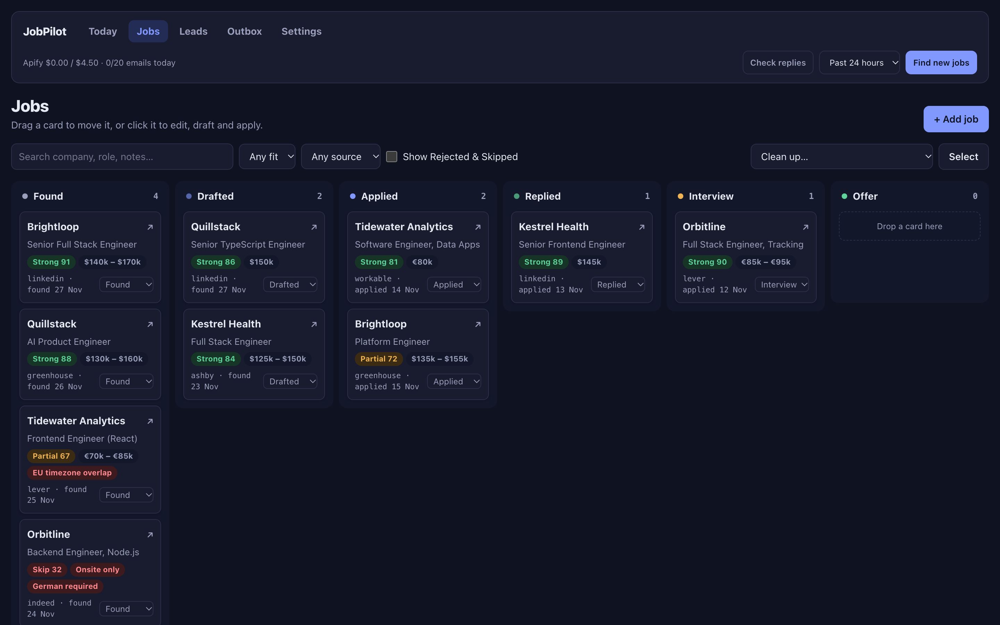
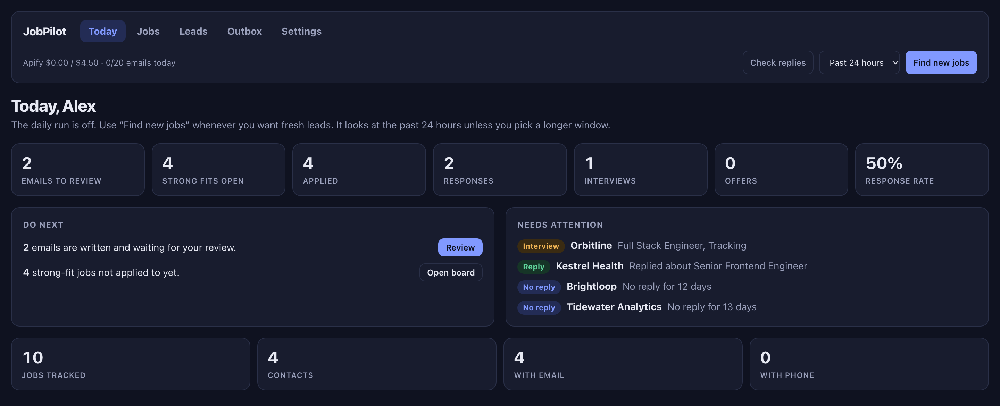
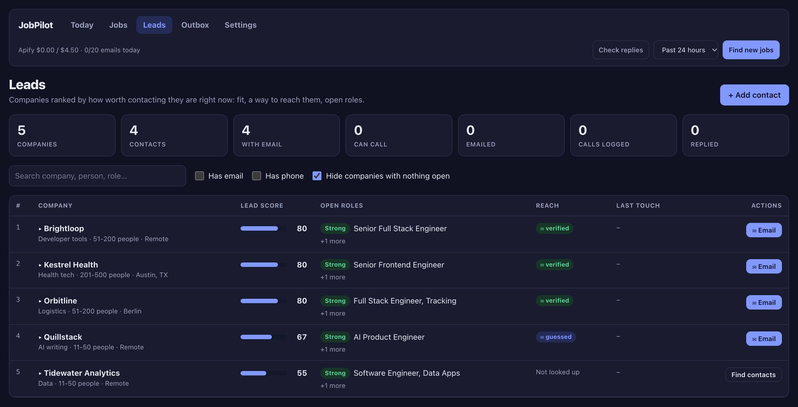
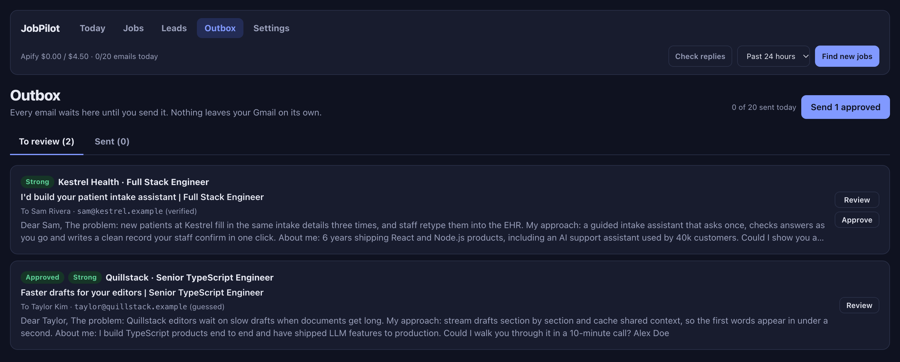

# JobPilot

[](https://github.com/mahermubeen/jobpilot/actions/workflows/ci.yml)

A job search dashboard that runs on your own computer. It finds jobs on
LinkedIn, Indeed and company career boards, finds the people behind them,
writes the email and a CV tailored to each job, and sends from your Gmail after
you review it. It also keeps a ranked list of companies you can call.

Everything (jobs, contacts, keys, your CV) is stored in the `data/` folder of
this project. Nothing is uploaded anywhere except the requests you trigger to
your own Apify, Gmail, Claude and (optionally) Apollo accounts.



<details>
<summary><b>More screens</b>: Today, Leads, Outbox</summary>

**Today**: what needs you now: drafts to review, strong fits, replies and follow-ups.



**Leads**: companies ranked by fit, reachability and open roles.



**Outbox**: every email waits for your review; nothing is sent without a click.



</details>

<sub>Screenshots use fictional demo data from `npm run seed:demo`.</sub>

## What it does

| Screen | What you do there |
|---|---|
| **Today** | See what needs you: emails to review, strong-fit jobs, replies, follow-ups due. |
| **Jobs** | Kanban board from Found to Offer. Open a job to write a draft, preview the tailored CV, or use the **Apply kit** for portal applications. |
| **Leads** | Companies ranked by lead score, with people, emails, phones, address and open roles. **Call** opens Zoom Phone, **Email** writes a draft. |
| **Outbox** | Every email waits here. Edit, approve, send one or send all approved. Sent emails show replies. |
| **Settings** | Search titles and locations, your master CV, connections, limits and run history. |

**Find new jobs** (top right) runs the whole pipeline:

1. Search LinkedIn, Indeed and Google (Greenhouse, Lever, Ashby and Workable boards).
2. Drop duplicates (same link, or same company and role).
3. Score each job against your CV: Strong, Partial or Skip, with red flags.
4. For Strong fits: find the company website, public emails and phone, and optionally people via Apollo.
5. Write the email subject, body and a CV selection for each Strong fit.
6. Check Gmail for replies and write follow-ups for emails with no answer.

The same pipeline runs once a day on its own (jobs from the last 24 hours)
while the app is open.

## Rules built in

- **Nothing is sent without a click.** The daily run only prepares drafts.
- **Tailored CVs cannot invent anything.** They select and reorder bullets,
  skills and projects from your master CV. Text that is not in the master CV is
  dropped in code (`lib/cv/variant.ts`), not just by the prompt. The headline
  and two-line summary are written fresh, so read them in the Outbox preview.
- **Send limits:** a daily cap (default 20), one first-contact email per
  address, no email to anyone marked "Do not contact", an extra confirmation
  for guessed addresses, and no automatic resend after a failure.
- **Spend limit:** every scraper run is checked against a monthly Apify cap
  (default $4.50) before it starts.
- **No bots on job portals.** LinkedIn and Indeed applications are submitted by
  you. The Apply kit copies the cover letter, downloads the CV and opens the
  listing.

## Pay and place filters

Set these in **Settings → Search → Pay and place**. They are off until you fill
them in.

- **Minimum pay.** A job is dropped when the top of its stated pay range is
  below your minimum. Other currencies are converted with the approximate rates
  in `lib/pay.ts`. Most listings state no pay; those are kept, and Claude is
  told your minimum so it can skip a job whose description reveals lower pay.
- **Drop equity-only, volunteer and unpaid jobs.**
- **Home city.** Onsite and hybrid jobs are kept only in this city. Remote jobs
  are kept from anywhere, and so are listings located only in a country, since
  that is how job boards often show remote roles.

The filters apply to every new search. To clean jobs you saved earlier, stop the
app and run `npm run prune:jobs` to see what would go, then
`npm run prune:jobs -- --apply` to back up the database and delete them.

## Filling application forms (browser extension)

The `extension` folder is a small Chrome extension that fills application
forms for you. It works in your own, logged-in Chrome.

1. Open `chrome://extensions`, switch on **Developer mode**, press **Load
   unpacked** and choose the `extension` folder. Pin the JobPilot icon.
2. Save your standing answers in **Settings → Application answers** (expected
   salary, notice period, work authorisation and so on).
3. On the Jobs board press **Open job post** on a job, start the application,
   then press the JobPilot icon → **Fill this page**. On a multi-step form,
   press it again on each step.

What it does and does not do:

- Contact details come straight from your CV. Other questions are answered by
  Claude from your CV, the job description, the drafted cover letter and your
  saved answers, as briefly as the question allows.
- A question those sources do not answer is **left empty and outlined in
  amber**. Salary, visa status, demographic questions and consent boxes are
  never guessed. Filled fields are outlined in green.
- It attaches the tailored CV PDF to résumé upload fields.
- It **never presses Next or Submit**. Read every answer before you submit.
- Some custom dropdowns and type-ahead boxes cannot be set by a script. Those
  are left amber for you.
- LinkedIn's terms do not allow third-party tools that automate its site. The
  extension acts only when you click and never submits, but use it on LinkedIn
  at your own risk. Company career pages (Greenhouse, Lever, Ashby, Workable)
  have no such rule.

To try it safely, open `extension/test-form.html` in Chrome and press the icon.
JobPilot must be running; if you changed its port, set the same port under
Settings in the extension popup.

JobPilot answers only its own extension. The key in `extension/manifest.json`
gives it the same ID on every computer, so other extensions you have installed
are refused, even for reads. If you loaded an older copy of the extension,
reload it once in `chrome://extensions`: it gets the fixed ID, and its port and
suggestion settings start fresh. Only if you pack your own build with another key,
set its ID in `JOBPILOT_EXTENSION_ID` in `.env`.

## Requirements

- **Node.js 20.19 or newer** ([nodejs.org](https://nodejs.org))
- **Claude**, one of:
  - [Claude Code](https://claude.com/claude-code) installed and signed in on
    this computer (no key to paste), or
  - an Anthropic API key
- **An Apify account** (free plan is enough) for the job and contact scrapers
- **A Gmail account** with an app password, to send and to detect replies
- Optional: an Apollo.io API key for named contacts, and Zoom Phone for calls

## Quick start

Copy or clone this folder, then inside it:

```bash
npm install
npm run build
npm start
```

Open http://127.0.0.1:3000 and follow the three setup steps:

1. **Connect your accounts**
   - *Claude:* keep "Use Claude Code on this computer", or paste an API key.
   - *Apify:* sign up at apify.com, copy the token from Settings → API & Integrations.
   - *Gmail:* turn on 2-Step Verification, then create an app password at
     https://myaccount.google.com/apppasswords and paste the 16 letters.
   - Each has a **Save & test** button.
2. **Your CV:** upload a PDF. Claude turns it into editable fields. Check them;
   this is the only source tailored CVs draw from.
3. **What to look for:** job titles and locations.

Finishing setup starts the first search. For development use `npm run dev`.

## What it costs

| Service | Used for | Typical cost |
|---|---|---|
| Apify | LinkedIn jobs ($0.0004 each), Indeed ($0.00005 each), Google search ($0.0005 per query), website contact lookup (about $0.01 per company) | About $0.10 to $0.15 per full run with the default settings. Apify's free plan includes about $5 a month. |
| Claude | Scoring, emails, CV selection | With Claude Code: your plan's Agent SDK credit covers `claude -p` usage (at the time of writing, $20 a month on Pro), then standard API rates if you have usage credits on. With an API key: a few cents per application. |
| Gmail | Sending and reply checks | Free |
| Apollo | Optional people lookup | One Apollo credit per revealed email, two people per company at most |

The Settings → Runs tab shows JobPilot's own Apify estimate next to the total
Apify reports for your account.

## Calling with Zoom Phone

The **Call** button opens `zoomphonecall://<number>`, which the Zoom desktop
app handles when Zoom Phone is signed in. The first time, your browser asks
whether to open Zoom; choose "Always allow". There is also a `tel:` button for
other phone apps and a copy button. Log the outcome after each call.

If you call UK numbers, check them against the TPS/CTPS register first.

## Your data

- Database: `data/db` (embedded Postgres via PGlite). Back up by copying the
  `data/` folder while the app is stopped.
- Keys are stored in that database on your disk and are never sent to the
  browser. `data/` is in `.gitignore`.
- The server listens on `127.0.0.1` only, so other devices on your network
  cannot reach it.
- Stop the app before running scripts that open the database; the embedded
  database allows one process at a time.

## Commands

| Command | What it does |
|---|---|
| `npm run dev` | Development server with reload |
| `npm run build` then `npm start` | Production server on http://127.0.0.1:3000 (`PORT=4000 npm start` to change the port) |
| `npm test` | Unit tests |
| `npm run typecheck` / `npm run lint` | Type and lint checks (lint includes the complexity, size and DSA limits, see below) |
| `scripts/check.sh` / `scripts/check.sh --full` | The quality gate: fast (secrets, lint, types, tests), or full (adds build, audit and a history secret scan). CI and the pre-push hook run `--full` |
| `npm run db:generate` | Create a migration after editing `lib/db/schema.ts` |
| `npm run import:artifact -- <folder>` | Import jobs exported as one JSON file each |
| `JOBPILOT_DATA_DIR=./demo-data npm run seed:demo` | Fill a new, empty data folder with fictional demo jobs, leads and drafts (then start the app with the same `JOBPILOT_DATA_DIR`) |
| `npm run prune:jobs` | List saved jobs outside your pay and place filters (`-- --apply` deletes them) |

## Project layout

```
app/                 pages and API routes
  api/               REST endpoints used by the pages
components/          shared UI, jobs board, settings sections
lib/
  apply/             application-form answers: validation and job matching
  ai/                provider interface, Claude Code and Anthropic API providers, prompts
  cv/                master CV types, honesty guard, PDF template
  db/                schema and database client (PGlite locally, Postgres via DATABASE_URL)
  mail/              SMTP send and IMAP reply check
  pipeline/          dedupe, lead score, send rules, pipeline steps and runner
  sources/           Apify actors (LinkedIn, Indeed, Google, contacts) and Apollo
  scheduler.ts       daily run
drizzle/             SQL migrations (applied automatically on start)
extension/           Chrome extension that fills application forms
scripts/             one-off scripts
tests/               unit tests
```

### Code limits

`npm run lint` fails on functions over 40 lines or with complexity over 10, nesting deeper than 3, more than 4
parameters, files over 400 lines, `await` inside a loop, and `find()` inside a loop (build a Map first).
The full list, and what is left to review instead of lint, is in `AGENTS.md`. Turn on the git hooks once
with `git config core.hooksPath .githooks`: commits run the fast gate and pushes run the full one.

### Changing things

- **Another scraper:** edit `lib/sources/actors.ts` (actor id and price) and
  the mapping in `lib/sources/jobs.ts`.
- **Another AI provider:** implement `AiProvider` from `lib/ai/provider.ts` and
  return it from `getProvider()`.
- **Another mail provider:** set the `JOBPILOT_SMTP_*` and `JOBPILOT_IMAP_*`
  variables from `.env.example`.
- **Hosted database (Supabase):** set `DATABASE_URL`; the same schema and
  migrations run there. Background runs and the scheduler assume a long-lived
  Node process, so a serverless host needs those moved to a cron or queue.
  There are no user accounts yet: do not put this on a public URL as it is.

## Known limits

- Many companies publish only a shared inbox, so some leads have no named
  person or phone number unless you add an Apollo key or enter them by hand.
- Google results give short descriptions; open the job and paste the full
  description for a better score and draft.
- Indeed country sites differ in coverage. Leave the Indeed country empty for
  a location to skip it.
- The Apollo integration and the Gmail reply check (IMAP) have not been run
  against live accounts yet; test them with **Save & test** and one real email
  to yourself before relying on them.
- Reply detection matches on the sender's address. A reply from a different
  address at the same company is not picked up; move the card by hand.

## Security

The app binds to `127.0.0.1`, rejects API calls from other websites and
foreign hosts (`proxy.ts`), and keeps every key and personal record in the
gitignored `data/` folder. See [SECURITY.md](SECURITY.md) for the full list
and known gaps.

## License

MIT. See `LICENSE`.
